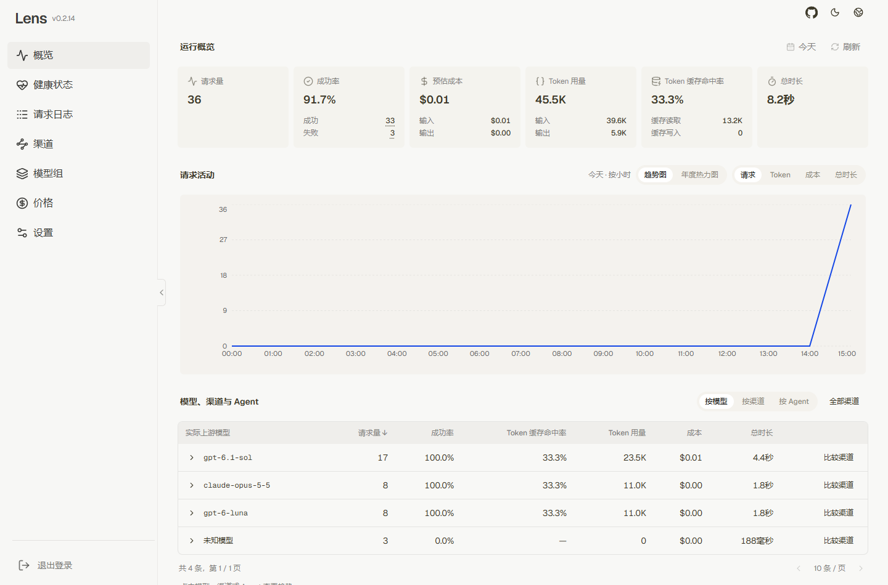
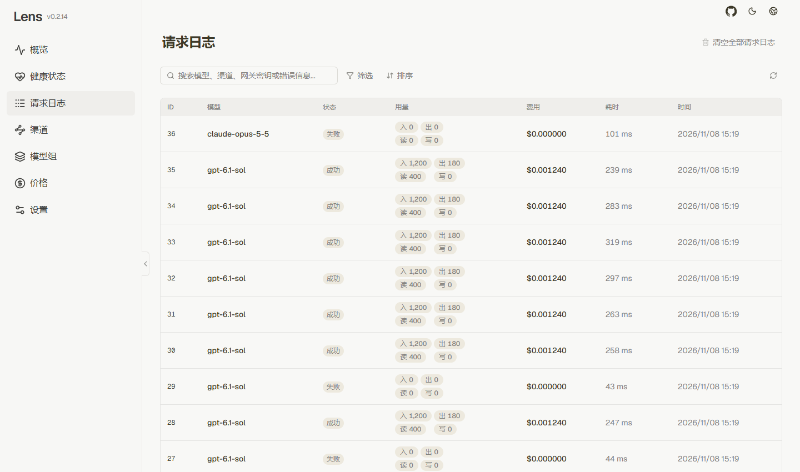
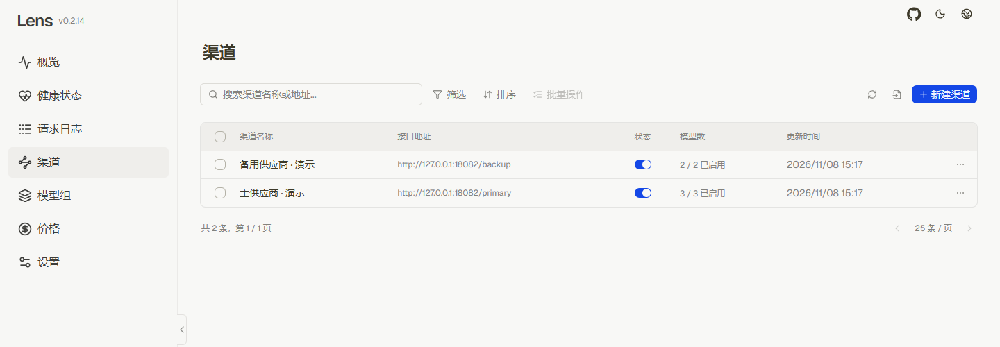
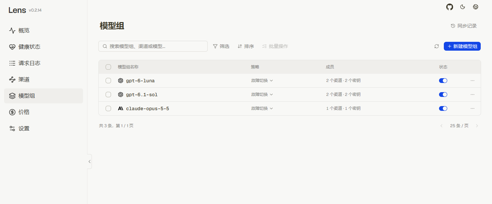
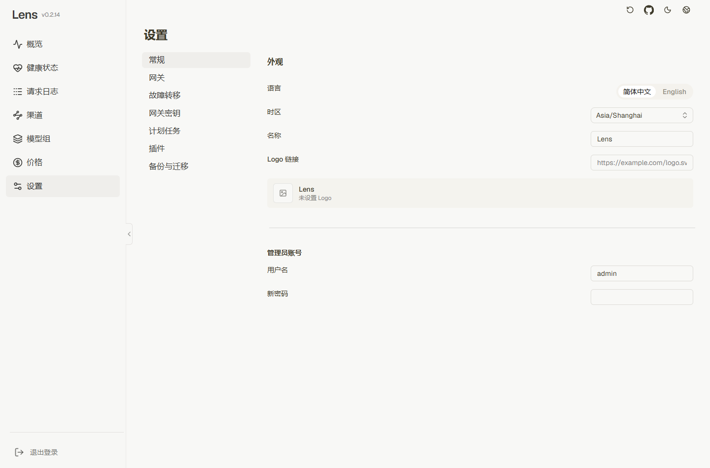
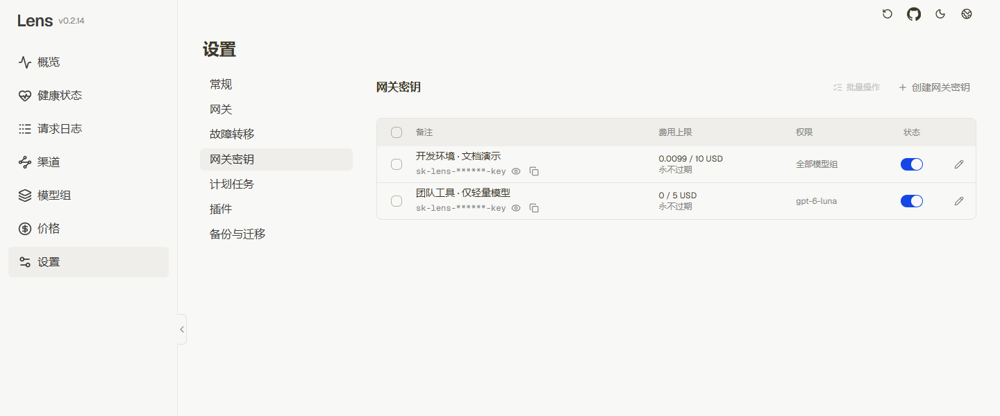
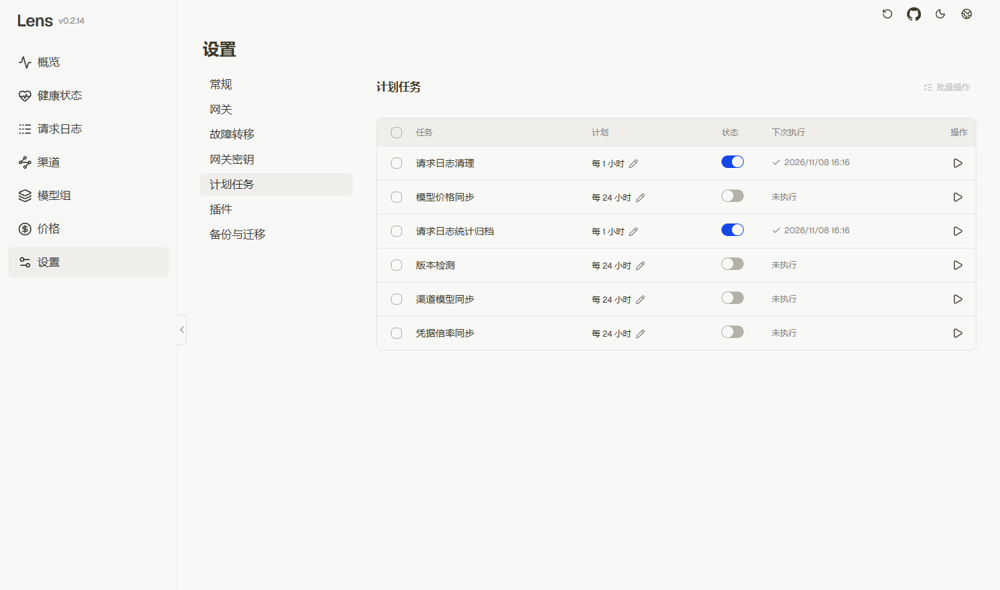
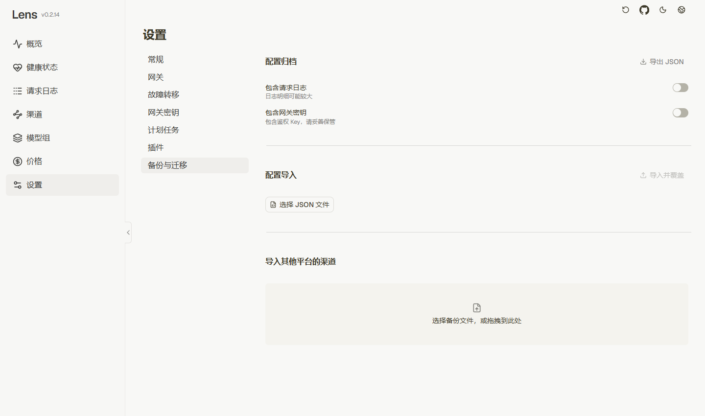

<p align="center">
  
</p>

<h1 align="center">Lens</h1>

<p align="center"><strong>让模型、供应商和工具，共用一个入口。</strong></p>
<p align="center">
  自托管多协议 LLM 网关，配备可视化管理界面。<br>
  一次接入，按需路由，看清每次请求的用量与费用。
</p>

<p align="center">
  <a href="https://github.com/dyedd/lens/releases"></a>
  <a href="./LICENSE"></a>
  <a href="https://github.com/dyedd/lens/stargazers"></a>
</p>

<p align="center">
  <a href="./README_EN.md">English</a> · <a href="https://dyedd.github.io/lens/">使用文档</a> · <a href="#快速开始">快速开始</a> · <a href="https://github.com/dyedd/lens/releases">版本发布</a>
</p>

**模型供应商可以换，客户端配置保持简单。** Lens 把上游地址、Key、模型、路由和用量集中到一处。你的应用和编程工具只需配置 Lens 地址、网关 Key 和模型组名称。

## 为什么选择 Lens

| 你需要做什么 | Lens 如何帮你 |
| --- | --- |
| 接入使用不同 API 的客户端 | 提供 OpenAI Chat、Responses、Embeddings、Images，以及 Anthropic、Gemini、Rerank 入口；支持的对话协议之间可转换 |
| 更换供应商时少改客户端 | 用模型组和别名提供稳定名称，在网关内调整上游成员 |
| 为故障准备备用渠道 | 配置主备切换、平滑轮询，结合健康状态与冷却管理调度请求 |
| 管理多个上游账号 | 集中维护多地址、多 Key、模型目录、同步规则与自动归组 |
| 看清费用和失败原因 | 查看用量与费用趋势、缓存统计、请求详情和每次上游尝试 |
| 掌握部署与扩展方式 | Docker 部署，支持 SQLite 或 PostgreSQL，提供备份与计划任务，使用 MIT 许可 |

## UI 集合

从请求概览到路由配置，再到日常维护，在一个管理界面中完成。点击图片可查看大图。截图使用虚构演示数据。

| 概览 | 请求日志 |
| --- | --- |
|  |  |
| **渠道管理** | **模型组** |
|  |  |
| **设置** | **网关密钥** |
|  |  |
| **计划任务** | **备份与迁移** |
|  |  |

## 快速开始

准备 Docker 和 Docker Compose，在 Linux / macOS 终端执行：

```bash
mkdir lens && cd lens
curl -fsSLO https://raw.githubusercontent.com/dyedd/lens/main/scripts/docker/deploy.sh
sh deploy.sh
docker compose pull
docker compose up -d
docker compose exec app cat /app/data/admin-password
```

打开 `http://127.0.0.1:3000`，用 `admin` 和命令读出的初始密码登录。登录后修改密码并删除初始密码文件。

接下来：**新建渠道 → 获取模型 → 检查模型组 → 创建网关 Key → 接入客户端**。详细步骤见 [快速开始](./docs/guide/quick-start.md)。

## 文档

| 使用与部署 | 开发 |
| --- | --- |
| [接入站点与模型](./docs/guide/sites.md) | [环境搭建](./docs/development/setup.md) |
| [模型组](./docs/guide/model-groups.md) · [客户端接入](./docs/guide/clients.md) | [系统架构](./docs/development/architecture.md) |
| [日志与排错](./docs/guide/monitoring.md) · [备份与维护](./docs/guide/maintenance.md) | — |
| [环境变量与网关设置](./docs/reference/configuration.md) | [文档站开发与发布](./docs/development/documentation.md) |

技术栈：Python 3.14+ / FastAPI / SQLAlchemy / SQLite 或 PostgreSQL；React 19 / TypeScript / Vite。

## 一起完善 Lens

如果 Lens 让你的模型接入更省心，欢迎 **点一个 Star**，让更多人发现它。

欢迎提交问题、改进文档或发起 PR。反馈问题时，请附上 Lens 版本、复现步骤和脱敏日志；参与开发可从 [环境搭建](./docs/development/setup.md) 与 [系统架构](./docs/development/architecture.md) 开始。

## 致谢与许可

感谢 [octopus](https://github.com/bestruirui/octopus)、[metapi](https://github.com/cita-777/metapi)、[ccLoad](https://github.com/caidaoli/ccLoad)、[DEEIX-Chat](https://github.com/DEEIX-AI/DEEIX-Chat) 和 [Linux DO 社区](https://linux.do/)。

[MIT](./LICENSE)
