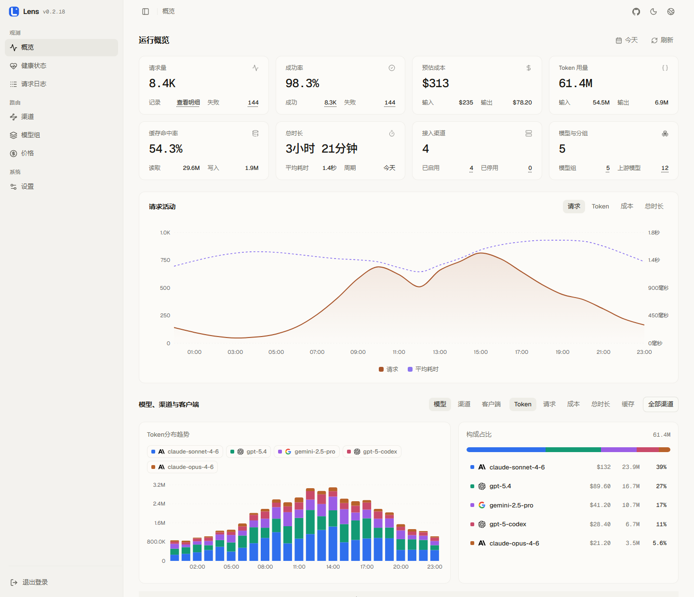
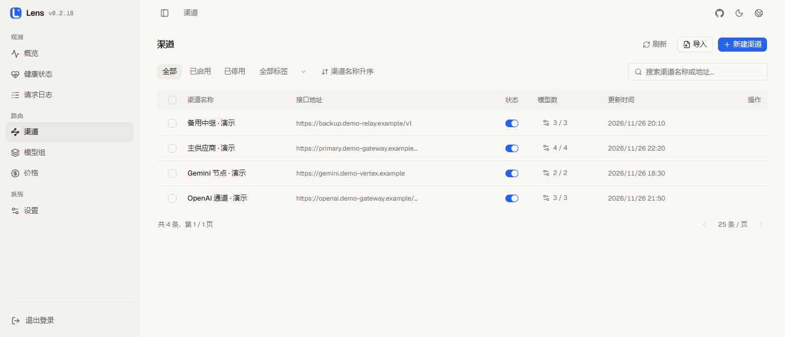
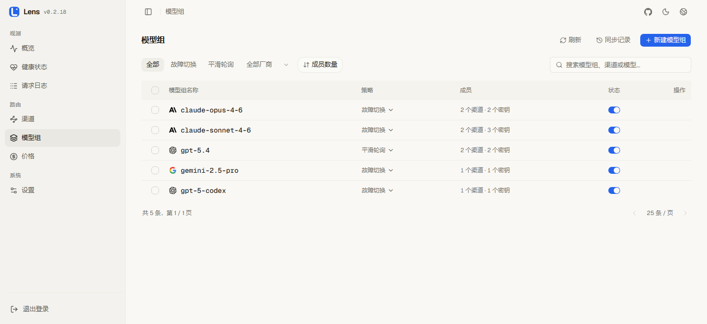
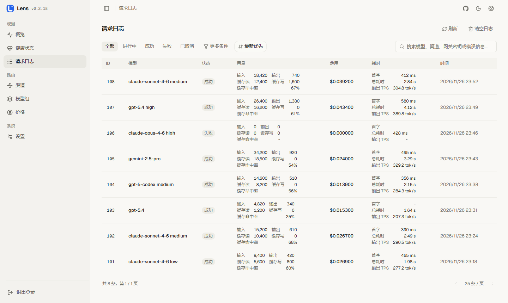

<p align="center">
  
</p>

<h1 align="center">Lens</h1>

<p align="center"><strong>让多供应商模型、协议转换与可观测性，收束为一个可控入口。</strong></p>
<p align="center">
  面向自托管场景的多协议 LLM 网关与可视化控制台。<br>
  一次接入客户端，在网关内完成模型归组、协议转换、故障转移、隐私脱敏与用量核算。
</p>

<p align="center">
  <a href="https://github.com/dyedd/lens/releases"></a>
  <a href="./LICENSE"></a>
  <a href="https://github.com/dyedd/lens/stargazers"></a>
</p>

<p align="center">
  <a href="./README_EN.md">English</a> · <a href="https://dyedd.github.io/lens/">完整文档</a> · <a href="#快速开始">快速开始</a> · <a href="./docs/development/architecture.md">系统架构</a> · <a href="./docs/development/source-guide.md">源码解析</a>
</p>

---

**客户端配置应当保持稳定，变化留在网关内部。** Lens 将上游站点地址、多把 API Key、模型目录、路由策略、协议转换、隐私规则与费用统计集中到同一套控制面中。你的应用或编程工具（Codex、Claude Code 等）只需配置 Lens 地址、网关密钥与模型组名称。

## 核心能力

| 场景 | Lens 的实现方式 |
| --- | --- |
| **多协议统一接入与互通** | 原生提供 OpenAI Chat / Responses / Embeddings / Images、Anthropic Messages、Gemini `v1beta` 与 Rerank 入口；对话类协议通过统一中间表示（Unified IR）双向转换，同协议直通保留 Prompt Cache 与原生状态 |
| **模型组与两层路由** | 以“执行组 + 别名组”解耦客户端模型名与上游拓扑；支持故障切换（Failover + 短期亲和）与基于健康分的平滑加权轮询（SWRR），支持多模态备用组与 `model(high)` 推理强度后缀 |
| **精细化熔断与自愈** | 区分 Key 级（401/403/429）与模型级（404/5xx/超时/网络）故障域，支持自定义正则检测规则、多 Key 限流升级、指数退避与冷却到期后的单探测租约（Probe Lease） |
| **站点、密钥与平台迁移** | 一条渠道集中管理多地址用途、多 Key 作用域、代理与 Header/参数覆盖规则；内置延迟探测、Codex/Claude 兼容性测试，支持从 Metapi、Sub2API、ccLoad、All API Hub、Octopus、CLIProxyAPI 一键迁移渠道 |
| **可观测性与计费核算** | 实时概览趋势、Agent/渠道/模型多维归因、完整上游尝试链、流式首字/总耗时追踪；同步 LiteLLM 价格表与 Sub2API/NewAPI 凭据倍率，按网关密钥设置额度与有效期 |
| **服务端规则隐私保护** | 本地规则引擎自动识别密钥与个人敏感信息，支持替换脱敏并可逆恢复（`mask`）、告警日志清理（`warn`）或本地拦截（`block`），无需额外下载模型 |

## 界面预览

覆盖用量概览、渠道与模型管理、路由策略与请求排障的完整控制台（截图使用虚构演示数据，更多页面见 [使用文档](https://dyedd.github.io/lens/)）：

| 用量与归因概览 | 渠道与多凭证管理 |
| --- | --- |
|  |  |
| **模型组与分发策略** | **请求日志与上游尝试链** |
|  |  |

## 快速开始

在已安装 Docker 与 Docker Compose 的 Linux / macOS 主机上运行：

```bash
mkdir lens && cd lens
curl -fsSLO https://raw.githubusercontent.com/dyedd/lens/main/scripts/docker/deploy.sh
sh deploy.sh
docker compose pull && docker compose up -d
docker compose exec app cat /app/data/admin-password
```

打开 `http://127.0.0.1:3000`，使用账号 `admin` 与上述初始密码登录，登录后请在 **设置 → 常规** 修改密码并删除初始密码文件。

> [!TIP]
> 首次接入只需五步：**新建渠道 → 获取模型 → 确认模型组 → 创建网关密钥 → 接入客户端**。
> 若需 1Panel 部署、PostgreSQL 连接、Windows 环境或安全加固说明，请阅读 [快速开始指南](./docs/guide/quick-start.md)。

## 文档导航

文档站（[dyedd.github.io/lens](https://dyedd.github.io/lens/)）提供完整中文指南与源码级设计解析：

| 使用与运维 | 架构与源码开发 |
| --- | --- |
| [快速开始与升级](./docs/guide/quick-start.md) · [配置参考](./docs/reference/configuration.md) | [本地开发环境](./docs/development/setup.md) |
| [接入站点与模型](./docs/guide/sites.md) · [管理模型组](./docs/guide/model-groups.md) | [系统设计与架构](./docs/development/architecture.md) |
| [客户端接入（SDK / Codex / Claude Code）](./docs/guide/clients.md) | [核心工作流解析](./docs/development/workflow.md) |
| [用量监控、隐私与排错](./docs/guide/monitoring.md) · [设置、备份与迁移](./docs/guide/maintenance.md) | [源码结构与扩展指南](./docs/development/source-guide.md) |

技术栈：`Python 3.14+` · `FastAPI` · `SQLAlchemy` · `SQLite / PostgreSQL` · `React 19` · `TypeScript` · `Vite`

## 参与与贡献

Lens 致力于成为清晰、可扩展的自托管网关底座——如果你关注多模型路由稳定性、协议兼容或自托管工具链，可以 **Watch 版本发布** 或在社区交流你的真实使用场景，帮助我们持续打磨默认策略。

无论你想修复一个小问题，还是扩展新的协议与迁移器，源码都有明确的模块边界：

- **扩展协议与兼容性**：在 [`converters/`](./backend/app/gateway/converters) 中为新协议编写一对 `parse_*` / `build_*` Spoke 函数即可接入全协议互通矩阵
- **新增平台迁移器**：在 [`foreign_site_import/`](./backend/app/gateway/service/admin/foreign_site_import) 中添加格式识别与解析器
- **改进路由、界面或文档**：从 [环境搭建](./docs/development/setup.md)、[系统架构](./docs/development/architecture.md)、[核心工作流](./docs/development/workflow.md) 和 [源码解析](./docs/development/source-guide.md) 快速上手
- **反馈问题**：提交 [GitHub Issue](https://github.com/dyedd/lens/issues) 时附上版本号、复现步骤与脱敏后的请求日志或尝试记录

## 致谢与许可

感谢 [octopus](https://github.com/bestruirui/octopus)、[metapi](https://github.com/cita-777/metapi)、[ccLoad](https://github.com/caidaoli/ccLoad)、[DEEIX-Chat](https://github.com/DEEIX-AI/DEEIX-Chat) 与 [Linux DO 社区](https://linux.do/) 提供的灵感与生态支持。

基于 [MIT License](./LICENSE) 开源。
