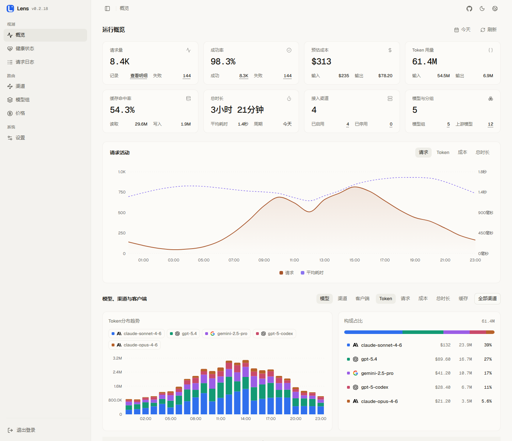
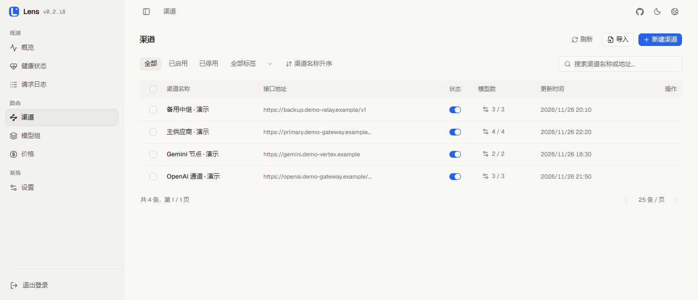
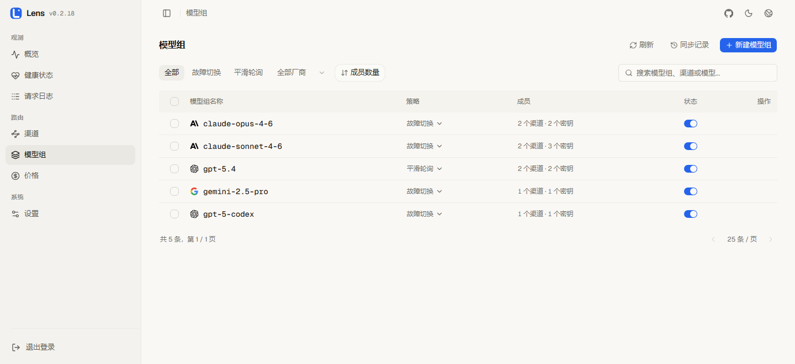
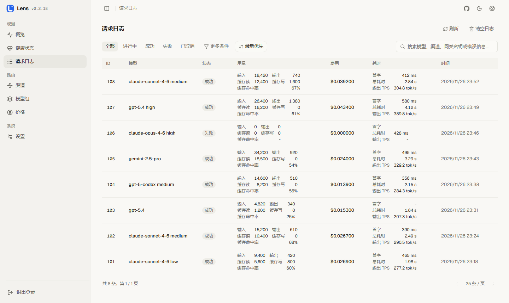

<p align="center">
  
</p>

<h1 align="center">Lens</h1>

<p align="center"><strong>One unified control plane for your LLM providers, protocol translation, and observability.</strong></p>
<p align="center">
  A self-hosted, multi-protocol LLM gateway with a visual management console.<br>
  Configure your clients once — handle model grouping, protocol bridging, failover, privacy masking, and cost tracking inside the gateway.
</p>

<p align="center">
  <a href="https://github.com/dyedd/lens/releases"></a>
  <a href="./LICENSE"></a>
  <a href="https://github.com/dyedd/lens/stargazers"></a>
</p>

<p align="center">
  <a href="./README.md">简体中文</a> · <a href="https://dyedd.github.io/lens/">Documentation</a> · <a href="#quick-start">Quick start</a> · <a href="./docs/development/architecture.md">Architecture</a> · <a href="./docs/development/source-guide.md">Source guide</a>
</p>

---

**Keep client configuration simple while upstream providers evolve.** Lens centralizes upstream base URLs, multiple API keys, model catalogs, routing groups, protocol conversion, privacy rules, and usage accounting. Your apps and coding agents (Codex, Claude Code, OpenAI/Anthropic/Gemini SDKs) only need a Lens URL, a gateway key, and a model group name.

## Key capabilities

| Area | How Lens handles it |
| --- | --- |
| **Multi-protocol ingress & bridging** | Exposes OpenAI Chat, Responses, Embeddings, Images, Anthropic Messages, Gemini `v1beta`, and Rerank endpoints; bridges conversation protocols via a Unified IR while passing same-protocol traffic through untouched to preserve prompt caching and server state |
| **Two-tier groups & smart routing** | Decouples client model names from upstream topology via Execution Groups and Alias Groups; supports ordered Failover (with short-term affinity), health-weighted Smooth Round Robin (SWRR), multimodal fallback groups, and reasoning-effort suffixes like `model(high)` |
| **Scoped circuit breaking & recovery** | Separates key-level faults (`401`/`403`/`429`) from model-level faults (`404`/`5xx`/timeout/network), with custom regex detection rules, multi-key rate-limit escalation, exponential backoff, and single-request probe leases on recovery |
| **Sites, keys & platform migration** | Manages endpoint purposes, per-URL credential scopes, proxies, and layered header/parameter overrides; includes latency probes, Codex/Claude compatibility tests, and channel import from Metapi, Sub2API, ccLoad, All API Hub, Octopus, and CLIProxyAPI |
| **Observability & cost accounting** | Tracks overview trends, model/channel/agent attribution, full upstream attempt chains, and TTFT/latency; syncs LiteLLM pricing and Sub2API/NewAPI rate multipliers with per-key USD budgets and expiry |
| **Server-side rule privacy** | Detects secrets and PII locally without external models; supports reversible placeholder masking (`mask`), log redaction (`warn`), or local blocking (`block`) |

## Interface preview

A unified console for analytics, provider management, routing groups, and request troubleshooting (screenshots use fictional demo data; see the [documentation](https://dyedd.github.io/lens/) for all screens):

| Overview & Attribution | Channels & Credentials |
| --- | --- |
|  |  |
| **Model Groups & Routing** | **Request Logs & Attempt Chain** |
|  |  |

## Quick start

On a Linux or macOS host with Docker and Docker Compose installed:

```bash
mkdir lens && cd lens
curl -fsSLO https://raw.githubusercontent.com/dyedd/lens/main/scripts/docker/deploy.sh
sh deploy.sh
docker compose pull && docker compose up -d
docker compose exec app cat /app/data/admin-password
```

Open `http://127.0.0.1:3000`, sign in as `admin` with the generated password, then change it under **Settings → General** and remove `/app/data/admin-password`.

> [!TIP]
> First-time setup takes five steps: **Create channel → Fetch models → Verify model group → Create gateway key → Connect client**.
> For 1Panel deployment, PostgreSQL setup, Windows instructions, or upgrades, see the [Quick Start Guide](./docs/guide/quick-start.md).

## Documentation

Full guides, workflows, and source-code walkthroughs live in the [documentation site](https://dyedd.github.io/lens/) (currently written in Simplified Chinese):

| Operations & Deployment | Architecture & Source |
| --- | --- |
| [Quick Start & Upgrades](./docs/guide/quick-start.md) · [Configuration Reference](./docs/reference/configuration.md) | [Local Development Setup](./docs/development/setup.md) |
| [Sites & Models](./docs/guide/sites.md) · [Model Groups](./docs/guide/model-groups.md) | [System Design & Architecture](./docs/development/architecture.md) |
| [Client Setup (SDKs / Codex / Claude Code)](./docs/guide/clients.md) | [Core Runtime & CI Workflows](./docs/development/workflow.md) |
| [Monitoring, Privacy & Troubleshooting](./docs/guide/monitoring.md) · [Settings, Backups & Migration](./docs/guide/maintenance.md) | [Source Code & Extension Guide](./docs/development/source-guide.md) |

Tech stack: `Python 3.14+` · `FastAPI` · `SQLAlchemy` · `SQLite / PostgreSQL` · `React 19` · `TypeScript` · `Vite`

## Contributing & getting involved

Lens is built to be an understandable, hackable foundation for self-hosted LLM routing. If you care about reliable multi-provider routing or protocol interoperability, feel free to watch releases for updates or share your deployment scenarios in GitHub Issues to help shape sensible defaults.

Whether you are fixing a subtle edge case or extending Lens with new capabilities, the codebase keeps clear boundaries:

- **Extend protocol support**: Add a `parse_*` / `build_*` spoke pair in [`converters/`](./backend/app/gateway/converters) to join the full chat protocol matrix
- **Add backup importers**: Implement format detection and mapping in [`foreign_site_import/`](./backend/app/gateway/service/admin/foreign_site_import)
- **Improve routing, UI, or docs**: Start with [Development Setup](./docs/development/setup.md), [Architecture](./docs/development/architecture.md), [Workflows](./docs/development/workflow.md), and the [Source Code Guide](./docs/development/source-guide.md)
- **Report issues**: Open a [GitHub Issue](https://github.com/dyedd/lens/issues) with your Lens version, reproduction steps, and redacted request logs or attempt chains

## Acknowledgments & license

Thanks to [octopus](https://github.com/bestruirui/octopus), [metapi](https://github.com/cita-777/metapi), [ccLoad](https://github.com/caidaoli/ccLoad), [DEEIX-Chat](https://github.com/DEEIX-AI/DEEIX-Chat), and the [Linux DO community](https://linux.do/) for inspiration and ecosystem support.

Released under the [MIT License](./LICENSE).
