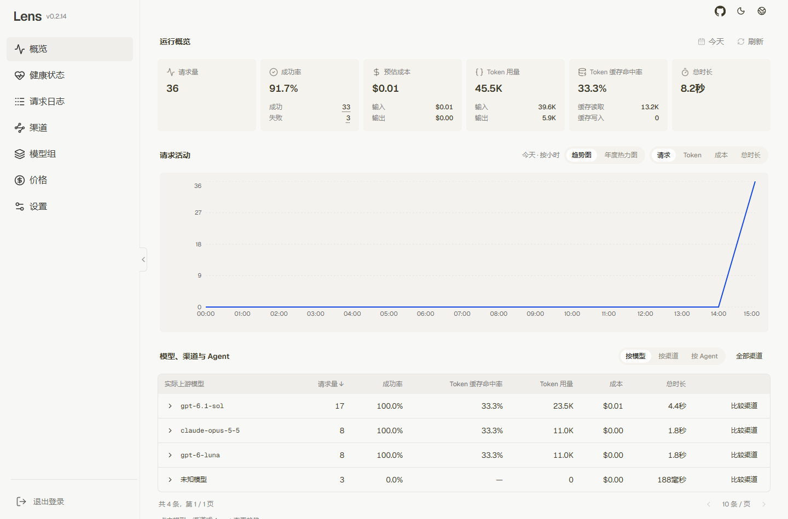
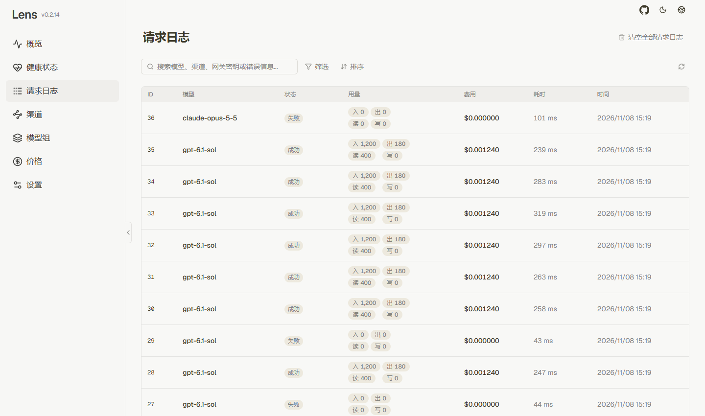
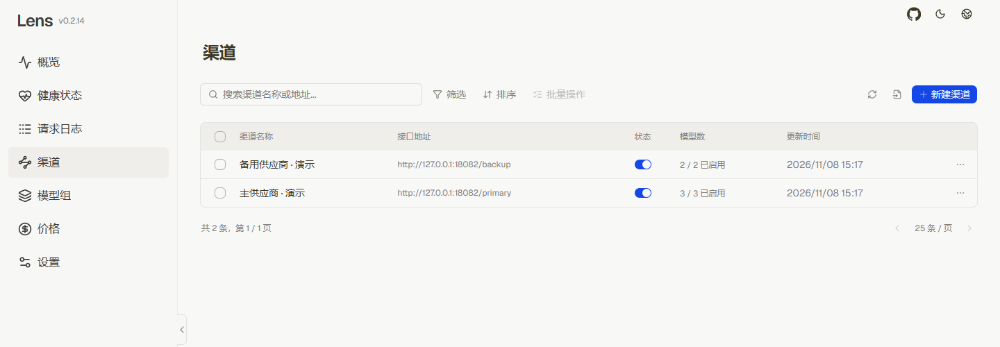
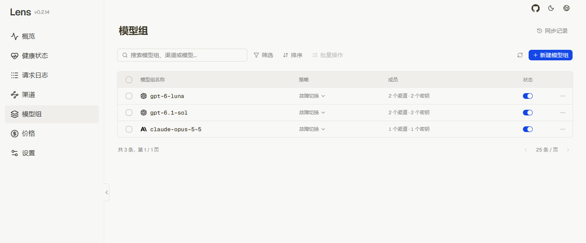
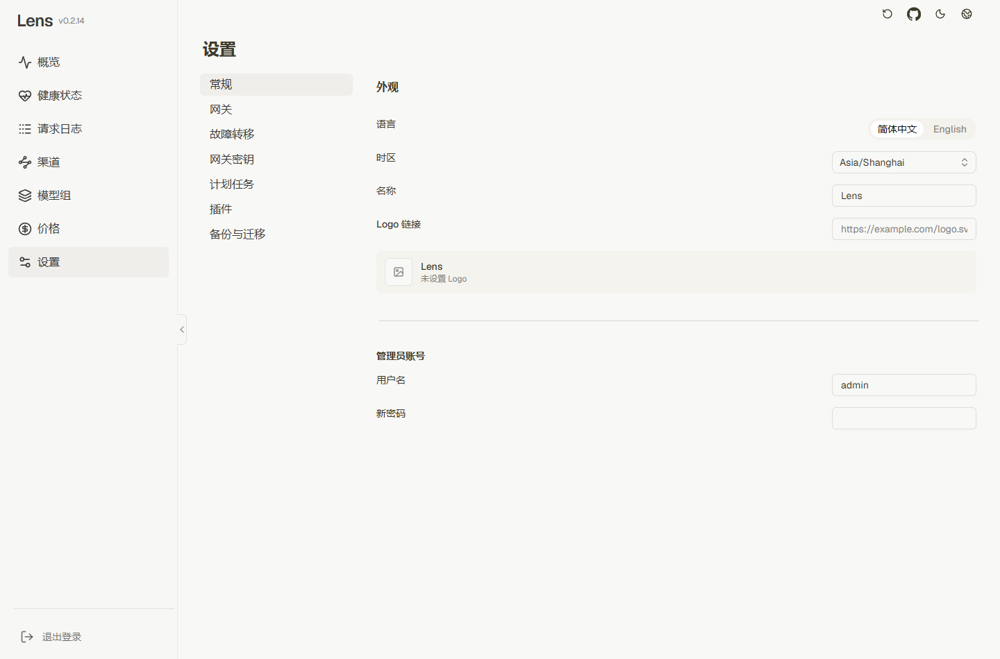
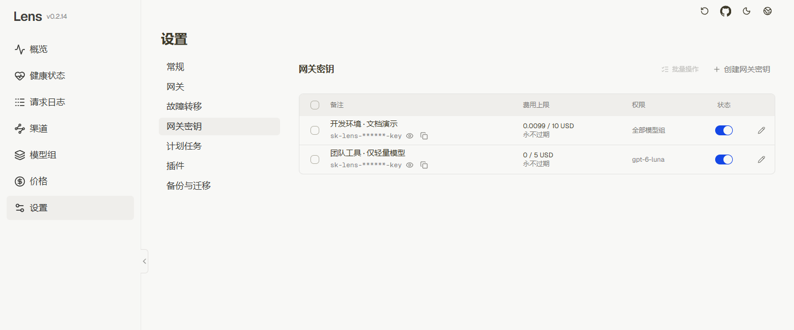
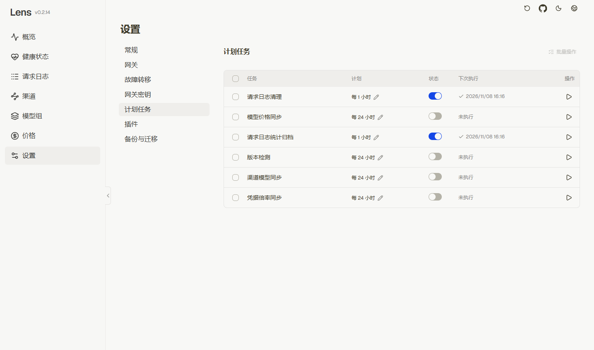
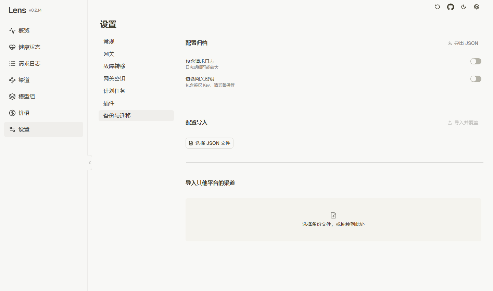

<p align="center">
  
</p>

<h1 align="center">Lens</h1>

<p align="center"><strong>One gateway for your models, providers, and tools.</strong></p>
<p align="center">
  A self-hosted LLM gateway with a visual control panel.<br>
  Connect once. Route across providers. See what every request costs.
</p>

<p align="center">
  <a href="https://github.com/dyedd/lens/releases"></a>
  <a href="./LICENSE"></a>
  <a href="https://github.com/dyedd/lens/stargazers"></a>
</p>

<p align="center">
  <a href="./README.md">简体中文</a> · <a href="https://dyedd.github.io/lens/">Documentation</a> · <a href="#quick-start">Quick start</a> · <a href="https://github.com/dyedd/lens/releases">Releases</a>
</p>

**Keep your client setup simple, even as your model providers change.** Lens brings upstream URLs, keys, models, routing, and usage into one place. Connect your apps and coding tools with a Lens URL, a gateway key, and a model group name.

## Why Lens

| What you need | What Lens gives you |
| --- | --- |
| Connect clients that use different APIs | OpenAI Chat, Responses, Embeddings, and Images; Anthropic, Gemini, and Rerank endpoints, with conversion between supported conversation protocols |
| Switch providers without editing every client | Model groups and aliases give clients stable names while you change upstream members |
| Keep a backup ready | Ordered failover, smooth round robin, health tracking, and cooldown controls |
| Manage several upstream accounts | Multiple URLs and keys, model discovery, sync rules, and automatic group assignment |
| Understand usage and failures | Usage and cost trends, cache statistics, request details, and the upstream attempt history |
| Run it on your own terms | Docker deployment, SQLite or PostgreSQL, backups, scheduled tasks, and Python plugins under the MIT license |

## UI gallery

Overview, routing, and maintenance in one control panel. Click an image to view it at full size. Screenshots use fictional demo data.

| Overview | Request logs |
| --- | --- |
|  |  |
| **Channels** | **Model groups** |
|  |  |
| **Settings** | **Gateway keys** |
|  |  |
| **Scheduled tasks** | **Backups and migration** |
|  |  |

## Quick start

Install Docker and Docker Compose, then run in a Linux / macOS shell:

```bash
mkdir lens && cd lens
curl -fsSLO https://raw.githubusercontent.com/dyedd/lens/main/scripts/docker/deploy.sh
sh deploy.sh
docker compose pull
docker compose up -d
docker compose exec app cat /app/data/admin-password
```

Open `http://127.0.0.1:3000` and sign in as `admin` with the generated password. Change the password after signing in, then delete the initial password file.

Next: **add a channel → fetch models → check model groups → create a gateway key → configure your client**. See the [quick start guide](./docs/guide/quick-start.md) for details.

## Documentation

The detailed guides are currently written in Simplified Chinese.

| Operation and deployment | Development |
| --- | --- |
| [Providers and models](./docs/guide/sites.md) | [Local environment](./docs/development/setup.md) |
| [Model groups](./docs/guide/model-groups.md) · [Client setup](./docs/guide/clients.md) | [Architecture](./docs/development/architecture.md) |
| [Logs and troubleshooting](./docs/guide/monitoring.md) · [Backups and maintenance](./docs/guide/maintenance.md) | [Plugin development](./docs/development/plugins.md) |
| [Environment variables and settings](./docs/reference/configuration.md) | [Documentation development and publishing](./docs/development/documentation.md) |

Stack: Python 3.14+ / FastAPI / SQLAlchemy / SQLite or PostgreSQL; React 19 / TypeScript / Vite.

## Get involved

If Lens makes your model setup easier, **give the project a Star**. It helps more people find it.

Bug reports, documentation improvements, and pull requests are welcome. For a bug report, include the Lens version, reproduction steps, and redacted logs. Start with the [development setup](./docs/development/setup.md) and [architecture guide](./docs/development/architecture.md) when contributing code.

## Acknowledgments and license

Thanks to [octopus](https://github.com/bestruirui/octopus), [metapi](https://github.com/cita-777/metapi), [ccLoad](https://github.com/caidaoli/ccLoad), [DEEIX-Chat](https://github.com/DEEIX-AI/DEEIX-Chat), and the [Linux DO community](https://linux.do/).

[MIT](./LICENSE)
